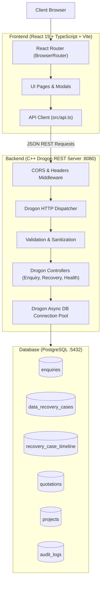
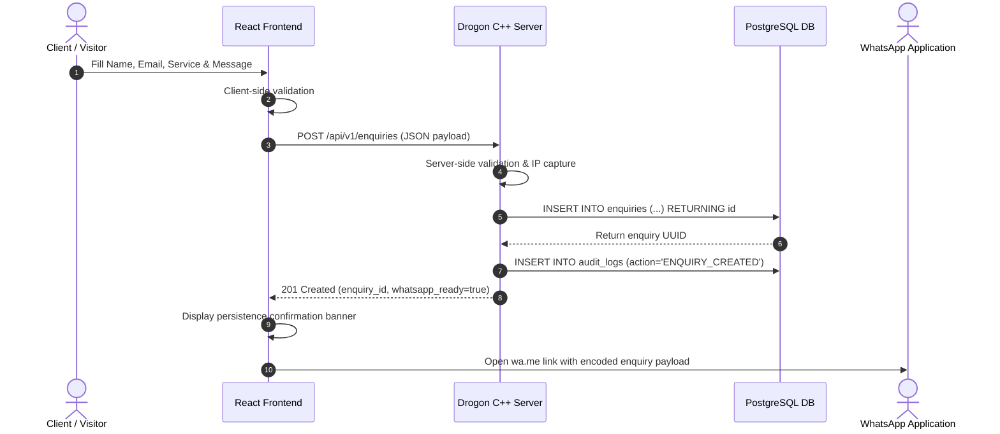
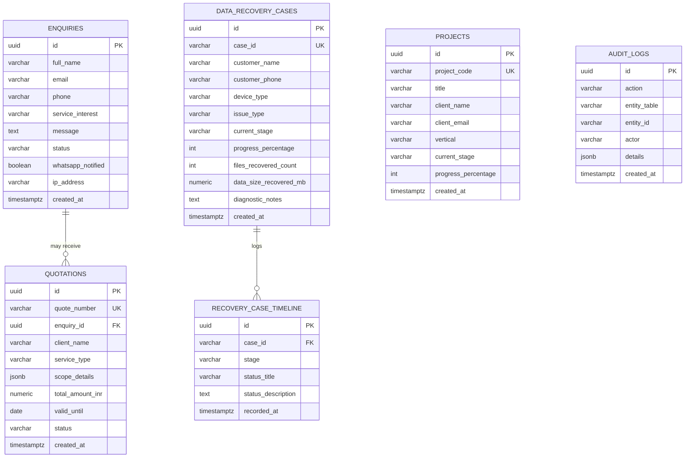

# MarsNova — Architecture & System Design

## 1. System Architecture Overview

MarsNova is architected as a decoupled, high-performance web platform consisting of a **React + TypeScript SPA frontend**, a **C++ Drogon REST API backend**, and a **PostgreSQL relational database** as the authoritative source of truth.



---

## 2. Communication & Handoff Pipeline

### Customer Enquiry Flow (Guaranteed Database-First Rule)
A core architectural requirement is that **no external notification or WhatsApp dispatch may be triggered until the enquiry is successfully committed to the database**.



---

## 3. Data Models & Relational Schema

The PostgreSQL schema is structured to ensure referential integrity, parameterized safety, and auditability.



---

## 4. Drogon REST API Specification

### 4.1 Health Check
- **Endpoint**: `GET /api/v1/health`
- **Response**: `200 OK`
  ```json
  {
    "status": "online",
    "service": "MarsNova C++ Drogon API",
    "version": "1.0.0",
    "timestamp": "2026-10-23 05:20:00"
  }
  ```

### 4.2 Customer Enquiry Submission
- **Endpoint**: `POST /api/v1/enquiries`
- **Headers**: `Content-Type: application/json`
- **Request Body**:
  ```json
  {
    "name": "Aarav Sharma",
    "email": "aarav@example.com",
    "phone": "+91 98765 43210",
    "service": "Video Editing",
    "message": "Need complete post-production for 12 YouTube episodes."
  }
  ```
- **Responses**:
  - `201 Created`:
    ```json
    {
      "success": true,
      "enquiry_id": "8d3e9114-1e09-4672-995b-09c33bb35ce2",
      "message": "Enquiry saved to database before WhatsApp dispatch",
      "whatsapp_ready": true
    }
    ```
  - `400 Bad Request`: Validation failure message (e.g., invalid email, short name).
  - `500 Internal Server Error`: Database connection or insertion fault.

### 4.3 Data Recovery Case Status Lookup
- **Endpoint**: `GET /api/v1/recovery/:caseId`
- **Responses**:
  - `200 OK`:
    ```json
    {
      "case_id": "MN-REC-8291",
      "customer_name": "Aditya Verma",
      "device_type": "SanDisk Ultra 64GB USB 3.0",
      "issue_type": "Corrupted Master Boot Record & RAW Partition",
      "current_stage": "file_recovery",
      "stage_title": "Deep File Structure Reconstruction",
      "progress_percentage": 75,
      "files_recovered_count": 1420,
      "data_size_recovered_mb": 18450.5,
      "diagnostic_notes": "Controller healthy. Raw NAND sectors mirrored.",
      "created_at": "2026-10-21T09:30:00Z",
      "updated_at": "2026-10-23T04:15:00Z",
      "timeline": [...]
    }
    ```
  - `404 Not Found`: If no case matches the specified identifier.

---

## 5. Security & Data Integrity Principles

1. **SQL Injection Defense**: Strict use of parameterized positional placeholders (`$1, $2, ...`) via `drogon::orm::DbClient::execSqlAsync`.
2. **Audit Trails**: Critical state modifications (new enquiries, quotation generation, case stage updates) record an entry in `audit_logs` capturing the entity ID, action name, actor, and JSON details.
3. **CORS Policy**: Configured in `backend/config.json` and enforced in Drogon post-handling advice hooks to restrict cross-origin access in production.
4. **Client-Side Graceful Degradation**: If the backend service is offline, the React frontend buffers enquiries in `localStorage` under `marsnova_enquiries` to ensure no prospective client inquiry is lost.
