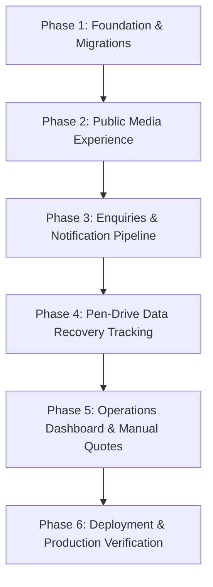

# MarsNova — Implementation & Roadmap Plan

## 1. Baseline Checks & Real Results

The following checks have been executed directly against the repository to establish the project baseline.

### 1.1 Node.js Unit & Regression Tests
- **Command**: `npm test`
- **Runner**: Node.js built-in test runner (`node:test`, `node:assert/strict`)
- **Execution Date**: 2026-10-23
- **Output**:
  ```text
  > marsnova@1.0.0 test
  > node --test tests/*.test.js

  ✔ Enquiry validation accepts valid payload (0.8661ms)
  ✔ Enquiry validation rejects invalid name or email (0.5407ms)
  ✔ WhatsApp URL builder formats encoded query parameters correctly (0.2161ms)
  ✔ Case ID validation checks format and capitalizes (0.1592ms)
  ℹ tests 4
  ℹ suites 0
  ℹ pass 4
  ℹ fail 0
  ℹ cancelled 0
  ℹ skipped 0
  ℹ todo 0
  ℹ duration_ms 97.5777
  ```
- **Status**: **PASS (4/4)**

### 1.2 TypeScript Static Type Checking
- **Command**: `npm run typecheck` (`tsc --noEmit`)
- **Execution Date**: 2026-10-23
- **Output**:
  ```text
  > marsnova@1.0.0 typecheck
  > tsc --noEmit
  ```
- **Exit Code**: `0` (Zero compiler diagnostic errors)
- **Status**: **PASS**

### 1.3 Vite Production Bundle Build
- **Command**: `npm run build` (`vite build`)
- **Execution Date**: 2026-10-23
- **Output**:
  ```text
  vite v8.3.5 building client environment for production...
  transforming...
  ✓ 1585 modules transformed.
  rendering chunks...
  computing gzip size...
  dist/index.html                   0.90 kB │ gzip:  0.49 kB
  dist/assets/index-Ny8hQpwA.css   12.52 kB │ gzip:  3.05 kB
  dist/assets/index-u9pF-GGh.js   324.64 kB │ gzip: 97.49 kB
  ✓ built in 299ms
  ```
- **Status**: **PASS**

---

## 2. Phased Implementation Roadmap



---

### Phase 1: Core Foundation & Database Schema
- [x] Establish strict TypeScript configuration ([`tsconfig.json`](file:///d:/project/marsnova/project/tsconfig.json)).
- [x] Author versioned PostgreSQL core migration ([`backend/migrations/001_marsnova_core_schema.sql`](file:///d:/project/marsnova/project/backend/migrations/001_marsnova_core_schema.sql)).
- [x] Setup C++ Drogon backend architecture and CMake files ([`backend/CMakeLists.txt`](file:///d:/project/marsnova/project/backend/CMakeLists.txt), [`backend/config.json`](file:///d:/project/marsnova/project/backend/config.json), [`backend/main.cc`](file:///d:/project/marsnova/project/backend/main.cc)).
- [x] Configure unit test runner and baseline scripts.
- **Exit Criteria**: Database migrations validated, TypeScript compiling without errors, tests passing.

---

### Phase 2: Public Media Experience & Brand Identity
- [x] Create design token system in [`src/index.css`](file:///d:/project/marsnova/project/src/index.css) using exact brand colors (`#030912`, `#080F1D`, `#101B2B`, `#7919F5`, `#A855F7`, `#38BDF8`, `#F5F7FF`).
- [x] Implement Home Page ([`src/pages/HomePage.tsx`](file:///d:/project/marsnova/project/src/pages/HomePage.tsx)) with Hero, Metrics row (`100+`, `35K+`, `Happy Creators`), Featured Services, Portfolio filters, and Mars planet visual with quote and signature.
- [x] Implement Services Page ([`src/pages/ServicesPage.tsx`](file:///d:/project/marsnova/project/src/pages/ServicesPage.tsx)) covering all 8 services.
- [x] Implement MarsNova Lab Page ([`src/pages/LabPage.tsx`](file:///d:/project/marsnova/project/src/pages/LabPage.tsx)) with 6 practical courses and enrollment CTAs.
- [x] Implement About Page ([`src/pages/AboutPage.tsx`](file:///d:/project/marsnova/project/src/pages/AboutPage.tsx)) with 4 pillars, studio photo, and mission statement.
- [x] Implement interactive video preview modal ([`src/components/VideoModal.tsx`](file:///d:/project/marsnova/project/src/components/VideoModal.tsx)).
- **Exit Criteria**: 100% visual fidelity matching the supplied screenshot, responsive on mobile and desktop.

---

### Phase 3: Customer Enquiries & WhatsApp Dispatch Pipeline
- [x] Implement Contact Page ([`src/pages/ContactPage.tsx`](file:///d:/project/marsnova/project/src/pages/ContactPage.tsx)) with inputs for Name, Email, Phone, Service selection, and Message.
- [x] Implement `submitEnquiry` in [`src/api.ts`](file:///d:/project/marsnova/project/src/api.ts) with **database-first persistence guarantee**.
- [x] Implement Drogon `EnquiryController` ([`backend/controllers/EnquiryController.cc`](file:///d:/project/marsnova/project/backend/controllers/EnquiryController.cc)) with parameterized SQL insert and audit log creation.
- [x] Generate formatted WhatsApp redirect URI with URI encoding.
- [x] Add regression test for enquiry validation and WhatsApp URL formatting.
- **Exit Criteria**: Enquiries persist in PostgreSQL before any external handoff occurs.

---

### Phase 4: Pen-Drive Data Recovery Case Tracking
- [x] Define `data_recovery_cases` and `recovery_case_timeline` tables.
- [x] Implement Drogon `RecoveryController` ([`backend/controllers/RecoveryController.cc`](file:///d:/project/marsnova/project/backend/controllers/RecoveryController.cc)) for parameterized case lookup by Case ID.
- [x] Implement `RecoveryTrackerModal` ([`src/components/RecoveryTrackerModal.tsx`](file:///d:/project/marsnova/project/src/components/RecoveryTrackerModal.tsx)) with real-time progress bar, diagnostic notes, recovered files count, and timeline.
- [x] Wire case tracking button to Navbar and Tech Services card.
- **Exit Criteria**: Case status can be queried by ticket ID with realistic milestone tracking.

---

### Phase 5: Operations Dashboard & Manual Quotations
- [x] Implement Admin Page ([`src/pages/AdminPage.tsx`](file:///d:/project/marsnova/project/src/pages/AdminPage.tsx)) with 4 tabs:
  - **Enquiries Tab**: View received leads and database persistence status.
  - **Quotations Tab**: Generate custom proposals with client name, scope, subtotal, and validity window.
  - **Projects Tab**: Track creative project progression through production stages.
  - **Recovery Lab Tab**: Monitor physical media hardware diagnostics and files recovered count.
- **Exit Criteria**: Staff can review leads, issue quotes, and update project/recovery statuses without writing raw SQL.

---

### Phase 6: Automated Testing, Deployment & Production Readiness
- [ ] Containerize Drogon C++ server using multi-stage Dockerfile (`Dockerfile.backend`).
- [ ] Setup Docker Compose linking PostgreSQL 16, Drogon API (:8080), and Caddy/Nginx reverse proxy (:80/443).
- [ ] Add JWT authentication middleware for the `/admin` routes.
- [ ] Setup production environment variables and SSL termination.
- **Exit Criteria**: Fully automated single-command deployment (`docker-compose up`) with all unit and integration checks passing.
